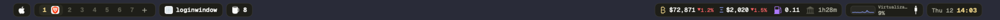

<div align="center">



# tip

**A fast, native menu bar for macOS: islands, themes and plugins.**

Workspaces, now playing, network, CPU, battery, markets and a clock in rounded islands along the top of every display.<br>
Event-driven, no polling scripts, no Lua, no helper binaries. Pure Swift and AppKit. Third sibling of [paw](https://github.com/pseudobun/paw) and [hop](https://github.com/pseudobun/hop).

[](https://github.com/pseudobun/tip/actions/workflows/ci.yml)
[](https://github.com/pseudobun/tip/releases)
[](#requirements)
[](Package.swift)
[](LICENSE)

[Install](#install) · [Features](#features) · [Configure](#configure) · [Plugins](#plugins) · [Commands](#commands) · [Development](#development)

<br>



<sub>The OG theme: <code>tip preview</code> renders your own bar to a PNG.</sub>

</div>

> [!NOTE]
> tip is in **beta**. It runs as a daily driver, but config keys and commands may still change
> before 1.0. Read the [changelog](CHANGELOG.md) when you upgrade.

## Install

### 1. Install with Homebrew

```sh
brew install --cask pseudobun/tap/tip
```

This puts `tip.app` in `/Applications` and the `tip` CLI on your `PATH`. Betas: `pseudobun/tap/tip@beta`.
From source: `just install` (see [Development](#development)).

### 2. Hide the system menu bar and stop other bars

tip draws over the top of the screen like SketchyBar. Turn on **System Settings → Control Center →
Automatically hide and show the menu bar → Always**, and stop any other bar:

```sh
brew services stop sketchybar   # if you used it
```

### 3. Start tip

```sh
open -a tip
```

There is nothing to grant: tip needs **no** Accessibility, Screen Recording or other permission
(the Wi-Fi name in the network popup asks for Location the first time it shows). Turn on
**Open at login** in Settings (`tip settings`) or set `openAtLogin: true`.

### 4. Check it works

```sh
tip status     # version, displays, items and plugins, memory
tip query      # what every bar shows
tip doctor     # costly or broken setups
```

The first launch writes a commented `~/.config/tip/config.json5` with every default.

### Updates

tip looks for a new version once a day (Sparkle, from GitHub releases), downloads it in the
background and installs it when tip quits. `tip update` installs now; `tip update --check` only
looks. Homebrew users can also `brew upgrade --cask pseudobun/tap/tip`.

### Uninstall

```sh
brew uninstall --cask pseudobun/tap/tip            # the app and CLI
brew uninstall --zap --cask pseudobun/tap/tip      # also ~/.config/tip and caches
```

## Requirements

macOS 26 or later, Apple silicon. [paw](https://github.com/pseudobun/paw) for workspaces (optional),
[media-control](https://github.com/ungive/media-control) for now playing (optional,
`brew install media-control`).

## Features

### Islands, not hacks

An island is a first-class rounded group of items with its own padding, border and shadow (or
Liquid Glass). No edge spacers, zero-width frames or bracket tricks. Three zones per display:
left, center and right. The right zone gets space first, then left, then center; an island that
would run into the notch or the other zone hides, so the order never shuffles. The notch is
measured from the display (`auxiliaryTopLeftArea`), not hard-coded.

### Native and event-driven

Every built-in item listens to the system instead of polling a script:

| Item | Source | Wakes on |
|---|---|---|
| `clock` | timer aligned to the minute | minute boundary, clock/zone change, wake |
| `battery` | IOPowerSources notifications | power source change |
| `network` / `vpn` | SystemConfiguration (SCDynamicStore) | link or address change, a cable plug, VPN up/down |
| `cpu` | mach `host_statistics`, libproc per-process times | interval (2 s) |
| `memory`, `disk` | mach `host_statistics64`, volume resource values | interval, mounts |
| `front_app` | NSWorkspace activation | app switch |
| `media` | MediaRemote through one long-lived `media-control stream` | now-playing change |
| `volume` | CoreAudio property listeners | volume, mute, device change |
| `workspaces`, `zoom` | paw's socket event stream (no bridge process) | paw events |
| `brew` | a file watcher on the brew-refresh job's cache | file change |
| `apple`, `text` | static | — |
| `script` | `/bin/sh -c` per run | interval or tip events |

Measured with `tip bench` (release build, one display, every default item): **16 MB** footprint,
**~0.3 % CPU** (all of it the 2 s CPU sampler), **0 processes spawned** at rest. SketchyBar's setup it
replaces: 79 MB + 12 MB Lua + helpers, and a fork per update.

### Workspaces from paw

With paw running, the workspaces island shows each display's own workspaces: the number (accent
when focused), the apps on it as their real icons (faded off the focused one), the visible one on a
highlight, and a `+` for a new one. Click switches, right click closes, scrolling walks through them.
The zoom island shows how far paw zoomed in. tip talks to paw's public socket only, and reconnects by
itself when paw restarts; without paw the islands stay empty.

### Popups

Every item with something more to say opens a popup on click (or `click: "popup"`): Apple menu
shortcuts, network details (interface, Wi-Fi name, address, router, tunnels), battery, the busiest
processes, now playing with controls, the date and week. Plugins fill their own.

### Themes and a theme builder

Six themes shared with paw and hop: **OG** (default: olive-black islands, gold clock, Geist Mono),
**OG Light**, **Modern**, **Minimal**, **Solarpunk** and **Cyberpunk**, or `follow-paw` /
`follow-hop` to use whatever theme they have. Settings → Appearance shows each as a tile; hovering
one previews it **on the real bar**, a click switches.

Make your own in Settings (**Customize…**) or with `tip theme new "Nord" --from modern`: a commented
`~/.config/tip/themes/nord.json5` with every colour token, the font, size, corner radius, border and
shadow. The builder edits it live (colour wells, font picker, sliders); the bar follows as you drag.
Font files in the themes folder are loaded too. Token names match hop's, so palettes move between
the three apps.

### Zen mode

Click the clock (or `tip zen`, or `zen.hotkey`) to hide everything but `zen.keep`.

### Built for scripts and agents

Everything visible can be read and changed from the shell: `tip query --json`, `tip set`,
`tip click`, `tip trigger`, `tip subscribe` (JSON lines, a snapshot first), `tip config set`. The
config file is the source of truth; Settings and the CLI edit it in place, keeping comments.

## Configure

`~/.config/tip/config.json5` (`TIP_CONFIG` overrides it). Every key is optional and has a
default; `items` and `layout` merge over the defaults key by key, so a config only says what it
changes. Saved changes apply at once; a broken file keeps the last good config and shows a red dot
at the left edge of the bar until it reads again. `tip config check` names the problem with its line
and column, and suggests the key you probably meant.

```json5
{
  theme: "og",
  bar: { height: 40, margin: { left: 25, right: 34 } },
  island: { height: 28, gap: 6, padding: 10, spacing: 10, material: "solid" },

  layout: {
    default: {
      left: [["apple"], ["workspaces"], ["zoom"], ["front_app"], ["brew"]],
      center: [["media"]],
      right: [["markets"], ["cpu", "net", "battery"], ["clock"]],
    },
    builtin: { center: [] },              // the laptop's notch sits there
    "DELL U3223QE": { right: [["cpu"], ["clock"]] },
  },

  items: {
    clock: { format: "HH:mm", dateFormat: "EEE dd", click: "zen", zones: ["America/New_York"] },
    net: { provider: "network", click: "toggle-label" },
    uptime: { command: "uptime | awk '{print $3}'", interval: 300, icon: "sf:clock.arrow.circlepath" },
    media: null,                           // drop a default item
  },

  zen: { hotkey: "ctrl+alt+z", keep: ["workspaces", "zoom", "clock", "media"] },
  plugins: { "com.pseudobun.tip.markets": { etherscanKey: "${ETH_API_KEY}" } },
}
```

[`examples/config.json5`](examples/config.json5) is the full commented template (`tip config template`).

**Layout.** Each zone is a list of islands, each island a list of item ids. `default` applies to
every display; `builtin`, `external` or a display's name (`tip status` lists them) override single
zones. Displays narrower than `bar.minCenterWidth` hide the center zone.

**Items.** `provider` picks a built-in (table above), `plugin` shows a plugin's items, `command`
makes a script item. Every item also takes `click`, `rightClick`, `scrollUp`, `scrollDown`, `icon`
(`"sf:<SF Symbol>"`, `"app:<bundle id>"`, a file or text), `label`, `color` and `display`
(`all`, `main`, `builtin`, `external` or a name). Settings → Items lists each provider's options.

**Actions.** `zen`, `popup`, `toggle-label`, `open:<url or path>`, `app:<name>`, `shell:<command>`,
`paw:<command>` (over paw's socket), `hop:<args>`, `tip:<command>` (`reload`, `settings`, `quit`),
`media:toggle|next|previous`.

**Colours.** Theme tokens (`fg`, `muted`, `dim`, `accent`, `good`, `warn`, `bad`, `info`,
`chart1`…`chart5`, or any token name) follow theme switches; `"#rrggbb"` stays put.

**Secrets.** `${NAME}` reads `~/.config/tip/.env` (keep it out of git: commit a sops `.env.enc`).
Plugin `secret` preferences live in the login Keychain (Settings → Plugins, or `tip plugins set <id> <key> -`).

## Plugins

A plugin is a long-lived program in any language that speaks JSON-RPC 2.0 over stdin/stdout:
tip sends `initialize`, events and clicks, the plugin sends `set` with what its items show. One
process, idle while nothing changes, budgeted (30 sets/s, 64 KB per message, restarts with backoff,
then off), spawned as its own responsible process so it never inherits tip's permissions.

```sh
tip plugins install you/tip-weather          # latest GitHub release's .tipplugin.zip (--yes to confirm)
tip plugins link ~/src/my-plugin             # a folder you're working on
tip config set items.weather '{ plugin: "dev.you.weather" }'
tip plugins list · tip plugins logs <id> · tip plugins restart <id> · tip plugins disable <id>
```

**Markets** (`com.pseudobun.tip.markets`, bundled): BTC and ETH from Binance with the 24 h change,
the ETH base fee from Etherscan, and the NYSE open/close countdown. Click a price for its chart.

Write one with the Swift SDK (`sdk/swift`, `TipPluginKit`), the Rust SDK (`sdk/rust/tip-plugin`,
serde only), or no SDK at all:
[`examples/plugins/shell-counter`](examples/plugins/shell-counter/bin/counter) is 20 lines of
POSIX shell. The protocol, manifest and SDKs: [docs/plugins.md](docs/plugins.md).

## Commands

```
tip status [--json]             running, version, displays, items, plugins, memory
tip query [item] [--json]       what every bar shows
tip set <item> key=value…       icon label color iconColor detail drawing size bold click tooltip push; --reset
tip click <item> [trigger]      as if clicked: click rightClick scrollUp scrollDown
tip popup <item>                open or close its popup
tip trigger <event> [json]      a custom event for plugins and script items
tip subscribe [events…] [--reconnect] [--exec <cmd>]
tip zen [on|off|toggle]
tip theme [list|<name>|new <name> [--from <theme>]|template|path]
tip config path|check|show|get <key>|set <key> <json5>|unset <key>|template|edit
tip plugins list|install|link|remove|enable|disable|set|logs|restart
tip doctor · tip bench [seconds] · tip preview [out.png]
tip settings [page] · tip reload · tip update [--check] · tip quit · tip version
```

Exit codes: 0 ok, 1 error or not running, 3 needs `--yes`, 10 an update is available, 64 usage.
Events for `subscribe`: `snapshot itemChanged zenChanged themeChanged configReloaded displaysChanged
system_woke system_will_sleep network_change power_source_change front_app_switched media_change trigger`.

## Development

```sh
just build        # debug build
just test         # TipCore, the Swift SDK, the Rust SDK
just dev          # "tip Dev" (com.pseudobun.tip.dev, ~/.config/tip-dev, own socket) instead of the release tip
just undev        # back to the release tip
just install      # release build into /Applications/tip.app
just plugin-dev   # build plugins/markets and link it into the running tip
just preview      # every bar to build.noindex/preview.png
just bench        # idle CPU, wakeups and memory over 60 s
just log          # follow tip's log
```

Layout: `Sources/TipCore` (config, themes, layout solver, protocol; no AppKit, unit tested),
`Sources/tip` (`App`, `Bar`, `Render`, `Providers`, `Plugins`, `IPC`, `CLI`, `UI`), `plugins/`
(bundled plugins), `sdk/`, `examples/`. [PERFORMANCE.md](PERFORMANCE.md) has the budgets and
rules, [TESTING.md](TESTING.md) the manual checklist, [SECURITY.md](SECURITY.md) the trust model,
[docs/architecture.md](docs/architecture.md) the design.

### Releasing

Conventional commits on `main` (stable) or `beta` keep a release-please PR open; merging it tags
the version and runs `release.yml`: build, sign with Developer ID, notarize, staple, publish the
zip, update the Sparkle appcast (branch `appcast`) and the cask in `pseudobun/homebrew-tap`.
`just release` re-runs it for a tag.

## Contributing

Issues and pull requests are welcome. Keep `just test` green, follow
[Conventional Commits](https://www.conventionalcommits.org), and measure with `just bench` when a
change touches the bar or a provider.

## License

[MIT](LICENSE) © Urban Vidovič
